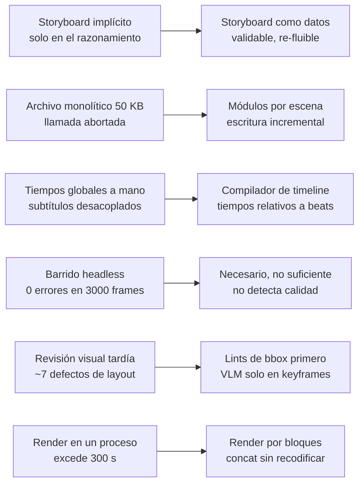
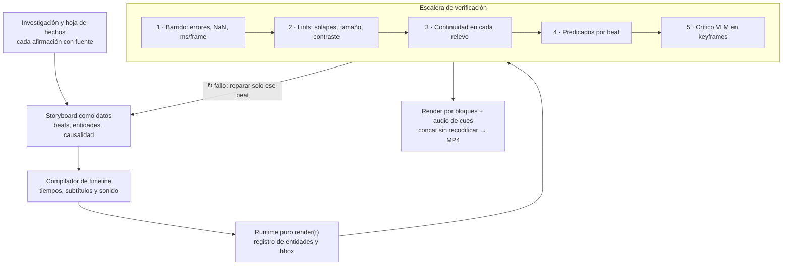

# FUNDAMENTOS — por qué opus-studio 3 está diseñado así

> Base: retrospectiva de *La imagen cambiante del universo* (5 min, Canvas) + contraste con opus-studio 1.

Retrospectiva de la película *La imagen cambiante del universo* (Canvas 2D, 5 min, 1600×900) y propuesta de sistema optimizado, contrastada con investigación de 2025–2026.

---

## 1. Qué funcionó y por qué

La decisión que más rindió fue una sola: **todo el estado de la película es función pura de `t`**. Esa pureza permitió, sin navegador:

- ejecutar la película en Node (`node-canvas` + `vm`);
- barrer 3000 fotogramas buscando excepciones y valores no finitos;
- generar hojas de contacto para revisión visual;
- sacar el MP4 con un audio idéntico al del navegador, sintetizado offline desde las mismas señales (`CUES`).

La industria ha convergido en la misma regla. Las guías de Remotion para agentes prohíben `Math.random`, `new Date()` y las animaciones CSS, y exigen que todo derive del número de fotograma (`useCurrentFrame()` + `interpolate`), porque las animaciones CSS no son deterministas y fallan al renderizar.

---

## 2. Retrospectiva: fallos y correcciones



| Etapa | Qué pasó | Corrección |
|---|---|---|
| Storyboard | Existió solo en el razonamiento; no era verificable | Storyboard como JSON validable |
| Escritura | Un archivo de ~50 KB en una sola llamada: abortada | Módulos por escena, escritura incremental |
| Tiempos | Segundos globales escritos a mano; al desplazar una escena 1 s hubo que recalcular subtítulos manualmente | Compilador de timeline con tiempos relativos al beat |
| Barrido headless | 0 errores en 3000 fotogramas | Necesario pero no suficiente: detecta fallos, no calidad |
| Revisión visual | ~7 defectos, todos de maquetación o continuidad (solapes ecuación/etiqueta, relevo planeta→piedra desalineado, destellos acumulados, marcas rojas demasiado grandes) | Lints deterministas de cajas primero; VLM solo al final |
| Render MP4 | Un proceso único superó el límite de 300 s; en segundo plano murió | 7 bloques de 1500 fotogramas (~80 s cada uno) + `ffmpeg -f concat -c copy` |

**El fallo de fondo es de orden:** revisé la imagen al final, con muestras elegidas a mano y a media resolución. Coincide con la literatura: la maquetación espacial es un cuello de botella fundamental en la generación de código de animación con LLM, y persiste incluso con arquitecturas multiagente (OmniManim). Un agente sin retroalimentación visual opera "a ciegas": emite instrucciones sin observar el resultado (Cutscene Agent).

### Métricas del proceso

- Código: 513 líneas, ~51 KB, 5 partes.
- Render: ~33 ms/fotograma (Canvas) + codificación x264 de un solo hilo ≈ 80 s por 1500 fotogramas.
- Salida: 9090 fotogramas, 303 s, ~19 MB (H.264 crf 18 + AAC 192 kbps).
- Defectos hallados por barrido: 0. Por revisión visual: ~7. Por lectura de código: 1 (color de token inválido).

---

## 3. Lo que dice la investigación (2025–2026)

- **Separación de roles.** Code2Video divide el trabajo en Planner (storyboard temporal), Coder (con reparación acotada, *scope-guided auto-fix*) y Critic (VLM con *visual anchor prompts*). Mejora un 40% sobre la generación directa de código. La reparación acotada es clave: se corrige el beat roto, no el guion entero.
- **Verificación formal antes que percepción.** MoVer expresa propiedades espacio-temporales (dirección, tiempos, posiciones relativas) como predicados de lógica de primer orden y devuelve al generador un informe de los predicados que fallaron. Más barato y fiable que pedir a un VLM que "mire si está bien".
- **Detección de solapes sin píxeles.** ManimAgent (proyecto open-source) extrae cajas delimitadoras del AST del código para prevenir colisiones de texto. Afirma que el renderizador en el bucle baja los errores de ejecución y maquetación de 65% a menos de 8%. *Cifra autodeclarada, sin revisión por pares.*
- **Retroalimentación por capturas.** PhysicsSolutionAgent combina RAG sobre la documentación de Manim, un ciclo de corrección de errores y un VLM que analiza fotogramas renderizados para dirigir mejoras concretas.
- **Planificación visual previa.** OmniManim mantiene un estado de escena compartido, separa parsing semántico, planificación de layout, generación de código y reparación local, y usa diagnósticos estructurados del render.
- **Memoria entre tareas.** ManimAgent (paper) busca que el agente retenga lecciones transferibles entre tareas en lugar de tratar cada vídeo como un problema aislado.

---

## 4. Sistema propuesto



### 4.1 Hoja de hechos
Cada fecha, nombre y afirmación física con su fuente. En la película, todas las fechas salieron de memoria sin verificación.

### 4.2 Storyboard como JSON
Cada beat declara: premisa, anomalía, transformación, estado final, entidades persistentes, duración, subtítulo, ecuación y sonido. Permite validar que cada beat tenga predecesor causal: la regla "sabíamos A → no explica C → surge D" se vuelve comprobable.

```json
{
  "id": "newton_orbit",
  "after": "galileo_parabola",
  "premise": "La caída es parabólica",
  "anomaly": "¿Qué pasa si se lanza más rápido?",
  "transform": "el suelo se revela esfera; la parábola se cierra en órbita",
  "entities": ["stone", "earth", "orbit_curve"],
  "duration": 14,
  "caption": { "year": "1687", "text": "Una sola ley para la piedra y los planetas" },
  "equation": "F = G M m / r^2",
  "cues": [{ "at": 0.9, "type": "rev" }],
  "predicates": ["stone.pos(start) == galileo_parabola.stone.pos(end) ± 2px"]
}
```

### 4.3 Compilador de timeline
Convierte duraciones en tiempos absolutos; adjunta subtítulos y cues al beat. Cambiar una duración re-fluye todo automáticamente.

### 4.4 Runtime con registros
- `render(t)` puro.
- Cada texto y ecuación registra su caja en cada fotograma.
- Cada entidad tiene un ID persistente; los relevos entre escenas se declaran, no se calculan a mano.

### 4.5 Escalera de verificación (de barata a cara)
1. **Barrido completo:** excepciones, valores no finitos, ms/fotograma.
2. **Lints deterministas:** intersección de cajas, tamaño mínimo de fuente a la resolución de destino (incluido móvil), margen seguro, contraste, número de elementos simultáneos (jerarquía visual).
3. **Continuidad:** diferencia de píxeles en `t ± ε` en cada relevo.
4. **Predicados por beat** (estilo MoVer): p. ej. "la piedra en el ápice en t = 53,0 ± 2 px".
5. **Crítico VLM** solo al final, con muestreo sistemático: inicio, medio y fin de cada beat + cada relevo. Nunca fotogramas elegidos a ojo.

**Ritmo medible:** un fotograma estático no juzga el tempo. Curva de "energía de movimiento" (cambio de píxeles por fotograma) superpuesta a los beats para verificar que las pausas previstas existen.

**Regla de reparación:** un fallo vuelve al beat que lo produce, no al guion completo.

### 4.6 Render
- Bloques en paralelo (uno por núcleo), cada uno bajo el límite de tiempo por llamada.
- `node-canvas.toBuffer('raw')` (formato `bgra`, ~2,5 ms) en vez de PNG (~45 ms).
- Unión con `ffmpeg -f concat -c copy`, sin recodificar.
- Audio sintetizado offline desde los mismos cues.

### 4.7 Memoria acumulativa
Una `SKILL.md` con las lecciones: reglas de maquetación, patrones de relevo, errores recurrentes.

---

## 5. Elección de herramienta

| Herramienta | Fortaleza | Debilidad | Cuándo usarla |
|---|---|---|---|
| **Motor propio Canvas** (el usado) | Sin dependencias; el mismo código corre en el artefacto y en Node; verificable sin navegador | Sin tipografía matemática real ni maquetación asistida | Películas conceptuales con morphing continuo entre escalas |
| **Manim** | LaTeX real; concentra casi toda la investigación con agentes | Python, renders más lentos | Cuando las ecuaciones son centrales |
| **Remotion** | Modelo de fotogramas estricto; habilidades oficiales para agentes | Árbol DOM → necesita navegador headless | Pipelines por lotes, vídeos con datos |
| **Motion Canvas / Revideo** | Línea de tiempo con generadores; sincronía con audio | Sin habilidad oficial para agentes (Revideo añade render en servidor) | Explicaciones vectoriales hechas a mano |

**Recomendación:** mantener el núcleo propio de función pura de `t` y añadir las capas 4.1–4.5. Migrar a Manim solo si la notación matemática se vuelve el cuello de botella.

---

## 6. Síntesis

La mayor ganancia no está en el motor. Está en **convertir la calidad en predicados verificables antes de gastar llamadas al modelo de visión**: storyboard como datos, tiempos compilados, cajas registradas, relevos declarados y verificación en escalera de barata a cara.

---

## Fuentes

- Code2Video: A Code-centric Paradigm for Educational Video Generation — https://arxiv.org/pdf/2510.01174
- MoVer: Motion Verification for Motion Graphics Animations — https://arxiv.org/pdf/2502.13372
- See Before You Code / OmniManim — https://arxiv.org/pdf/2605.15585
- PhysicsSolutionAgent — https://arxiv.org/pdf/2601.13453
- ManimAgent: Self-Evolving Multimodal Agents for Visual Education — https://arxiv.org/pdf/2606.30296
- ManimAgent (Manifund, cifras autodeclaradas) — https://manifund.org/projects/manimagent-an-open-25000-k12-video-library-
- Cutscene Agent — https://arxiv.org/pdf/2604.25318
- Remotion vs Motion Canvas — https://www.remotion.dev/docs/compare/motion-canvas
- Remotion skill (reglas de determinismo) — https://playbooks.com/skills/yuniorglez/gemini-elite-core/remotion-expert
- Remotion alternatives (Motion Canvas y agentes) — https://moda.app/blog/remotion-alternatives
- Remotion vs Motion Canvas vs Revideo — https://www.pkgpulse.com/guides/remotion-vs-motion-canvas-vs-revideo-programmatic-video-2026

---

## 7. Contraste con opus-studio 1 y decisiones de la fusión

opus-studio 1 era un sistema de **proceso** (dirección, gusto, paradas humanas) sin motor; el protocolo de arriba era un sistema de **verificación** sin taller de preproducción.

| Tomado de opus-studio 1 | Tomado del protocolo | Corregido en la fusión |
|---|---|---|
| Viñetas de trazo, STRIP, animatic, style lock | Determinismo `f(t)`, render headless | `shotAt` (un shot por t) → `seek` dibuja todos los activos |
| CRAFT: bans anti-template, spring, un eje de cámara | Hoja de hechos y causalidad por beat | Continuidad sin contrato → `handoffs` + `entities` |
| Paradas humanas y re-render por shot | Lints de cajas, predicados, energía de movimiento | Checks en casillas → `lint.mjs` ejecutable |
| Audio como reloj, loudnorm −14 | Render por bloques reanudable | Reglas de un solo género → perfiles `reel` / `explainer` |
| Revisión por roles sobre stills | Muestreo sistemático | Paradas solo humanas → modo autónomo con evidencia |

## 8. Versatilidad y gusto (v3)

Problema: opus-studio 2 verificaba bien pero tenía **un solo gusto** (editorial plano) escondido en `CRAFT.md` y en el lint. Decisión: separar tres ejes.

| eje | qué es | dónde vive | cómo se comprueba |
|---|---|---|---|
| **proceso** | etapas, gates, review | SKILL / PROMPTS / AGENTES | el orden y los gates |
| **perfil** | ritmo y exigencia (`reel`, `explainer`, `cinematic`) | `profiles.json` | holds, cortes, longitud de shot, lectura, causalidad, hechos |
| **estilo** | cómo se ve y se mueve | `styles/*.json` | paleta, cámara, composición, grade, bans |

El **gusto** se codifica en dos capas: prosa con el porqué y los números (`CINE.md`) y parámetros ejecutables en el pack. Lo medible se convierte en lint; lo que no, en el pase Review-Cine.

Qué se hizo ejecutable: cámara con vocabulario (push/pull/slide/pan/tilt/rotate/handheld) + `why` + límites de velocidad + continuidad (`chain`); composición por cajas (bordes, anclaje a centro/tercios, espacio negativo); tiempo de lectura; niveles tipográficos; contraste y croma en OKLCH; parallax por profundidad; grade (viñeta, grano determinista, letterbox, fundidos); efectos condicionados al estilo (`glow`, `gradient`).

Prueba de versatilidad: `npm run gallery` renderiza el **mismo** timeline en cada pack y lintea cada uno (seis estilos → SHIP). También se creó un estilo nuevo (`--new`, `--palette --apply`) y pasó el lint sin tocar código.

## 8b. Gramática de cine como datos (v3.5)

Punto de partida: el gusto se descompone en **predicción + un foco + identidad + cuerpo + cierre**; lo que se puede expresar como predicado sobre `t` entra al lint, lo demás al pase Review-Cine. Se añadió *gramática en datos* y *verbos en `api`*, sin motor 3D:
- `cam.why` cerrado (5 razones) y consistente con el movimiento; asentamiento (`delay`) tras un morph; un plano violento por acto.
- Taxonomía de transiciones con un predicado por tipo (el "cut" prohíbe identidad; el "morph" la exige).
- `motif` + `api.morph`: el morph se interpola en el espacio de la forma (caja redondeada con marco), no en píxeles.
- Pseudo-3D con luz-vector, sombra de contacto, suelo y parallax; stop-motion como cuantización del tiempo solo en el dibujo (`stepFps`, `smear`).
- Sombras medibles del cierre y del foco: peak-end, rima, competencia de focos, separación en grises. Van como **avisos**: son proxies, no el gusto.
Criterio de diseño: cifras como 80 %, 0.6×, 0.4–0.8 s o 35° son criterio, no medidas; se calibran con el primer film real.

## 9. Lecciones (se amplía al cerrar cada film)

- El barrido de errores no detecta calidad: 0 errores y ~7 defectos visuales en el mismo film.
- Todos los defectos visuales fueron de maquetación o continuidad → por eso existen `api.text/focus` y `handoffs`.
- Un archivo monolítico grande aborta la escritura: un módulo por shot.
- Tiempos globales a mano se rompen al mover una escena: tiempos relativos al shot.
- Autocorrelación de tempo sin prior cae en la octava inferior (60 vs 120 BPM): prior log-normal + regresión de onsets.
- loudnorm de una pasada sobre señales cortas y con picos no alcanza −14 LUFS: dos pasadas, y aun así el true peak manda.
- El lint solo ve lo que se registra: un acento dibujado sin `api.focus` pisó el tipo y pasó el lint. Todo elemento que el tipo no debe tapar se registra.
- Un mismo layout en píxeles absolutos rompe al cambiar de estilo (letterbox recorta el cuadro): el layout sale de `api.safe`/`api.at`.
- Un push de cámara mueve el texto hacia los bordes y lo saca de la safe area: el lint lo detecta porque mide cajas *ya proyectadas por la cámara*.
- Un anillo con texto dentro no es "texto sobre detalle": las cajas necesitan `hollow` para expresar interiores libres.
- Un umbral de "hold" calibrado en un estilo se dispara en otro más lento (muelles blandos): la energía de movimiento depende del estilo; hay `holdEnergy` por perfil y `popRatio` por estilo (brutalista con pasos = pops por diseño).
- Las bases tipográficas de un estilo deben cumplir el mínimo del perfil por defecto de ese estilo (`kinetic` y `brutalist` con base 30 fallaban en `reel`).
- Un estilo no cambia las capacidades del motor: 3D, metraje, voz y LaTeX siguen fuera de Canvas 2D.
- Un beat que coincide con la entrada por muelle no tiene valle previo: la firma de ritmo lo marca; se mueve el beat, no se silencia el check.
- Un demo que termina en reposo dispara peak-end: se le da un último acento en el beat final en vez de declarar `end_hold_ok`.
- Un morph solo es una transición si la cámara no salta y hay handoff: el lint rechaza los dos casos por separado.
- `stepFps` cuantiza el dibujo, no el reloj: el determinismo y los handoffs (que se evalúan en `t` exacto) no se rompen.


## v4 — de dirección codificada a motor de producción
La dirección (v3.5) ya era medible; el cuello de botella era el vocabulario gráfico y la producción. v4 conserva la invariante (`seek(t)` puro) y construye sobre ella: fragmentos cacheables, montaje por re-render, constraints por reevaluación temporal, motion blur exacto, índice consultable. Detalle de algoritmos y de los fallos de Manim, Motion Canvas, Remotion y agentes-animadores que se previenen: `MOTOR.md`.
