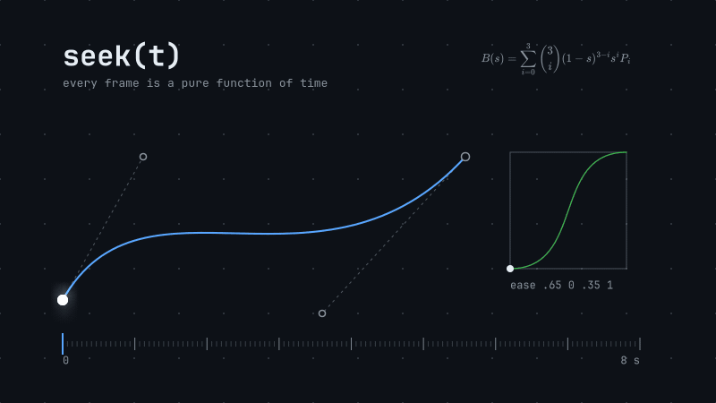

# opus-studio

[Español](README.es.md) · **English**

**A code-driven motion-graphics and cinematic production engine for autonomous agents: every frame is a pure function `seek(t)`, so every claim about a video can be checked by a program.**



<sub>This GIF was rendered by opus-studio itself (`seek(t)` → frames → ffmpeg): camera push/pull, cubic Béziers, an easing curve, real TeX, and a bloom + motion-blur compositor layer. Regenerate it with `npm run demo:gif`. Source: [`data/demo-gif/timeline.json`](data/demo-gif/timeline.json), [`shots/G_lib.mjs`](shots/G_lib.mjs), [`styles/suite.json`](styles/suite.json).</sub>

## Why `seek(t)`

A frame is `seek(ctx, t, film)`: a pure function of time. No hidden state, no `Math.random`, no `Date.now`, no "play from 0 to get to t". That single constraint is what lets an agent pipeline work on video the way it works on code:

- **Jump anywhere in O(1).** Render frame 3,812 without rendering frames 0..3,811 (simulations use checkpoints: at most 60 steps).
- **Verify before you look.** A linter measures what a human would eyeball: camera speed, text on top of subjects, safe areas, reading time, rhythm, palette contrast, determinism (`seek(t)` twice must give identical buffers). Agents get `file:line` and a suggested fix instead of "looks off".
- **Re-render only what changed.** Fragments are cached by a content hash of the engine imports, style, timeline inputs, shot code and assets. Touching a file without changing it invalidates nothing.
- **Query instead of re-watching.** A semantic index (boxes, camera, primitives, colour roles, physical symbols) answers "what is on screen at 3.2 s?" without a render.
- **Gates, not vibes.** `master` refuses to run without a fresh lint `SHIP` and a visual-critic verdict, and every forced override is written to a hash-chained ledger.

## Quick start

Requirements: **Node >= 22.15** and **ffmpeg** in `PATH`. Linux and macOS (CI: ubuntu-24.04 required, macOS experimental). `gl` and `three` are optional dependencies, only needed for the real-3D layer.

```bash
git clone https://github.com/Caelos-Palacio/opus-studio && cd opus-studio
npm ci
node engine/audio.mjs --click          # click-track audio for the demo film
npm run lint                           # demo film (editorial style) -> SHIP
npm run sheet                          # contact sheet -> out/sheets/contact.png
npm run master -- --force "local demo" # fragments + audio -> out/master.mp4 (-14 LUFS)
npm test                               # full regression suite (see Limitations)
```

`npm run master` without `--force` stops at the gate until the visual critic has a verdict for the current plan (`npm run critic` writes the contact sheets and packet; a vision-capable agent or `--api` returns the verdict). That is intentional.

Any command accepts `--timeline X --style Y --profile Z --edit E` (or `OPUS_TIMELINE`, `OPUS_STYLE`, `OPUS_PROFILE`, `OPUS_EDIT`), e.g. `OPUS_STYLE=noir npm run sheet`. Pin a film with `npm run use -- <film>`; every CLI prints `film: <key> (<path>, source: …)` on its first line.

To drive it with an agent, paste [`ORQUESTADOR.md`](ORQUESTADOR.md) (the brief template, in Spanish) into Claude Code and fill in the commission. English guides: [workflow and roles](docs/en/WORKFLOW.md) · [architecture](docs/en/ARCHITECTURE.md) · [styles](docs/en/STYLES.md).

## Features

- **One geometry: cubic Béziers** (`geom.mjs`). Full SVG path support (arcs included), glyph outlines, shapes. Arbitrary morphs with contour and hole matching, arc-length draw-on, vector warps (wave, bulge, twist, bend, noise, homography).
- **Real TeX** (`tex.mjs`). MathJax in pure JS, synchronous and cached. Stroke-to-fill writing and *semantic morph* (LCS over glyphs: identical symbols travel rigidly).
- **Semantic primitives** (`prims.mjs`). axes, plot, arrow, vector field, RK4 streamlines, trajectory, stateless particles (closed form), checkpointed sims, seeded force graphs, globe, auto-placed labels, image, footage, layers, 2.5D cards, atmosphere. Reference: [`docs/API.md`](docs/API.md) (generated by `npm run docs`).
- **Scene graph** (`scene.mjs`). Hierarchy, clips, local time and **per-node fps**, pure constraints (`follow` with lag = world at t − lag), stateless camera that tracks nodes with inertia.
- **2.5D and real 3D.** Perspective by z, fog, depth of field, true card flips; plus `world3d`, a headless-gl + three.js layer driven by declarative scene data and drawn in the style's palette (optional).
- **FX compositor** (`fx.mjs`). Reduction-chain blur, thresholded bloom, exact temporal-supersample motion blur, trails, directional blur, radial chromatic aberration, displacement, mesh warp, LUT grade with TPDF dither.
- **Autocamera** (`autocam.mjs`). Weighted least squares with second-order regularisation, minimum lambda by bisection that respects the style's speed limits, projection that keeps text inside the safe area.
- **Fragment montage** (`cut.mjs`). Content-hashed fragments plus a non-destructive EDL (speed, reverse, freeze re-rendered from source), two-pass loudness to -14 LUFS, bt709 tagging. OpenTimelineIO export: `npm run q -- otio`.
- **Sound** (`sound.mjs`). Deterministic voices, auto-SFX from the timeline, music with ducking, limiter.
- **Semantic index and queries** (`semindex.mjs`, `q.mjs`, `dsl.mjs`). Boxes, camera, nodes, colour to role, physical symbols (q̇ is not q), expiry hashes; a declarative scene DSL as an alternative to hand-written shots (JS stays as the escape hatch).
- **Guard and lint** (`guard.mjs`, `lint.mjs`). Static scan plus a `ctx` Proxy at lint time (raw text, absolute transforms, leaks, fake camera), mandatory focus per shot, per-shot determinism, prominence.
- **Visual critic** (`critic.mjs`). Colour/grey/annotated sheets, measured facts, closed rubric, schema-validated JSON verdict, hash-keyed cache. Fail-closed.
- **Governance** (`ledger.mjs`, `roles.mjs`, `gate.mjs`, `orch.mjs`). Hash-chained append-only ledger, per-agent HMAC signatures, role scopes enforced by a Claude Code hook, transactional gates, proposal/decision flow with a ratchet that rejects regressions.
- **Styles as data.** Eleven packs: `editorial`, `scientific`, `noir`, `kinetic`, `soft`, `brutalist`, `stopmo`, `cosmos`, `hierro`, `nocturno`, `pulso`, plus the `suite` pack used by the demo GIF. Three profiles (`reel`, `explainer`, `cinematic`) set rhythm and strictness independently. `npm run gallery` renders one film in every style.

## Architecture

```
brief -> STYLE -> audio -> timeline -> STORYBOARD => GATE -> animatic => GATE -> shots (parallel)
      -> autocam* -> LINT (+guard) -> index -> CRITIC => GATE -> sound -> master (fragments) [-> EDL]
                    ^ FIX: repair only that shot; only its fragment re-renders
```
`*` only if a shot uses `cam.move: "auto"`.

| Layer | What it decides | Where |
|---|---|---|
| process | storyboard, animatic, shots, lint, critic, master, with gates | [`docs/en/WORKFLOW.md`](docs/en/WORKFLOW.md), `PROMPTS.md`, `AGENTES.md`, `REVIEW.md` |
| profile | rhythm and strictness: `reel`, `explainer`, `cinematic` | `engine/profiles.json` |
| style | palette, type, springs, camera, grade, post, depth | `styles/*.json`, [`docs/en/STYLES.md`](docs/en/STYLES.md) |
| engine | geometry, TeX, primitives, scene graph, fx, sound, montage, index | `engine/*.mjs`, [`docs/en/ARCHITECTURE.md`](docs/en/ARCHITECTURE.md), [`docs/API.md`](docs/API.md) |
| governance | ledger, roles, gates, orchestration, budgets | `engine/ledger.mjs`, `roles.json`, `gates.json`, `orch.json` |

| Path | Contents |
|---|---|
| `engine/` | core (`core`, `geom`, `tex`, `prims`, `scene`, `fx`, `api`, `seek`, `camera`, `grade`, `styles`) and tools (`render`, `lint`, `guard`, `autocam`, `cut`, `sound`, `index`, `q`, `critic`, `assets`, `doc`, ...) |
| `shots/` | one `.mjs` per shot (demo A1-A3, demo GIF G01/G02, more films) |
| `data/` | `timeline.json` (demo), `timeline.template.json`, `edit.example.json` (EDL), one folder per film |
| `styles/` | style packs; `styles/medios/` paper/ink media; `styles/sound/` sound styles |
| `test/` | verifier mutations, unit tests, golden frames, fuzzers, fixtures |
| `docs/` | generated API, ADRs, specs, handoffs, roadmap (mostly Spanish) |
| `STATUS.md` | real state, generated by `node engine/status.mjs` |

### Commands

| Command | Output |
|---|---|
| `npm test` / `npm run test:fast` | regression suite; prints "Todo verde" when green |
| `npm run lint [-- --only validate\|determinism\|layout\|camera\|…]` | `out/lint.json`, SHIP / FIX |
| `npm run autocam` | `data/autocam/<timeline>.json` (auto-invalidated by hash) |
| `npm run sheet` · `strips` · `animatic` | contact sheets and strips |
| `npm run plan` | which fragments are cached / would render |
| `npm run review` · `npm run master` | `out/master.review.mp4` · `out/master.mp4` |
| `node engine/cut.mjs --edit data/edit.example.json` | EDL montage -> `out/main.edit.mp4` |
| `npm run sound` · `node engine/sound.mjs --list` | `data/mix.wav` + `out/sfx.json` · voice catalogue |
| `npm run index` · `npm run q -- at 3.2` (also `shot A2`, `sym q̇`, `tag tex`, `stale`, `deps`, `impact A2`) | index and render-free queries |
| `npm run critic [-- --api]` | `out/review/<film>/` sheets + `packet.md` (+ VLM verdict) |
| `npm run assets -- --tex` · `-- --footage clip.mp4 --id x` | precompile TeX · extract footage frames |
| `npm run docs` | regenerate `docs/API.md` |
| `npm run gallery` · `npm run styles` | one film in every style · list packs |
| `npm run golden` · `npm run metrics` · `npm run profile` | golden frames · measurable film metrics · per-frame cost profile |
| `npm run demo:gif` | regenerate `docs/media/demo.gif` with the engine |
| `npx serve .` then `/engine/preview.html?timeline=…&style=…` | browser scrubber (same `seek`) |

## Limitations

- **Documentation is mostly Spanish.** This README and [`docs/en/`](docs/en/) (workflow, architecture, styles) are English; the remaining deep docs (`CINE.md`, `CRAFT.md`, `FUNDAMENTOS.md`, `docs/specs/`, `docs/adr/`, `PROMPTS.md`, `AGENTES.md`, `REVIEW.md`, `ORQUESTADOR.md`) and CLI output are in Spanish. Identifiers and file names are kept as they are.
- **Canvas 2D first.** Rendering is node-canvas; shaders do not exist. Real 3D is the optional `world3d` layer (headless-gl + three.js; on Linux it needs Mesa/xvfb, and without it lint reports FIX for shots that use it). Raster warps operate in device pixels.
- **Fake camera is a warning, not an error:** an object that scales is legitimate and not always distinguishable from a scaled world.
- **Missing-font detection depends on fontconfig:** if it substitutes a metric-compatible font, no warning is raised. The demo GIF uses JetBrains Mono when installed and falls back to DejaVu Sans Mono.
- **Visual critic with `--api` has not been exercised** (no key was available to the authors). Without `--api` it produces sheets for a vision-capable agent.
- **`footage` has not been tested with a real clip** by the authors. In the browser preview, images and footage render as placeholders.
- **Cost** (author's measurement): about 100-165 ms/frame at 720p with all post effects, single core. Styles without post are much cheaper.
- **Autocamera smoothing** overshoots about 3 % on step changes; the feasible-set projection bounds it for zoom and framing.
- **`npm test` on a full clone** currently reports one failure, `gov: E9`, a false-positive-rate check over the repository's git history; the same suite is green in CI (shallow checkout). Everything else passes.
- The package is `private` (not published to npm); use it from a clone.
- Without a closed gate (human or autonomous) there is no film code and no master.

## License

[MIT](LICENSE)
